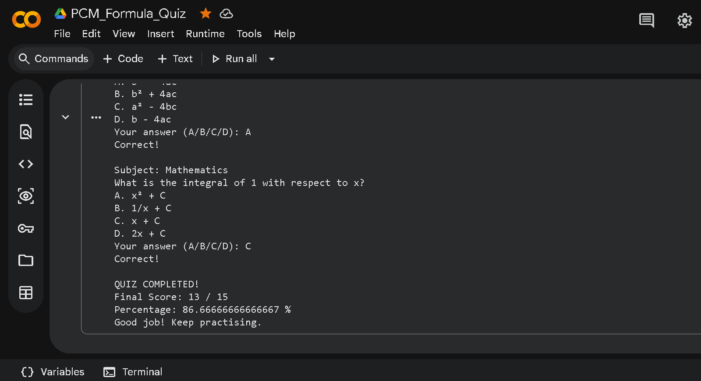

PCM Formula Quiz

A simple Python-based multiple-choice quiz covering Physics, Chemistry, and Mathematics.

Features
15 pre-defined multiple-choice questions.
5 questions from each PCM subject.
Instant feedback for correct and incorrect answers.
Automatic score calculation.
Final percentage and performance message.

Technologies Used
Python
Google Colab

How It Works
The program displays questions one by one and asks the user to select an option (A/B/C/D). After all 15 questions, it calculates the final score and percentage.

Project Status
Completed – A working beginner-level Python quiz project.

Author
Bobbili Sai Satvik

## Quiz Result

